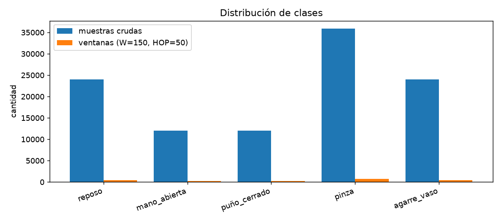
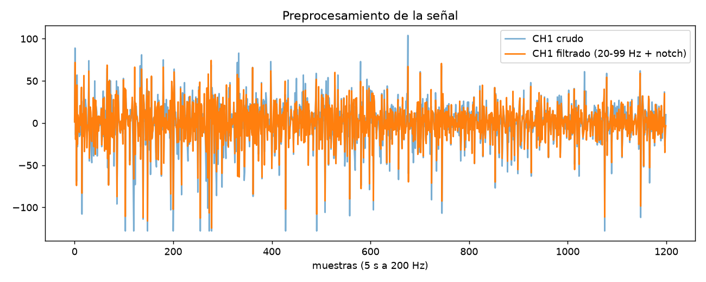
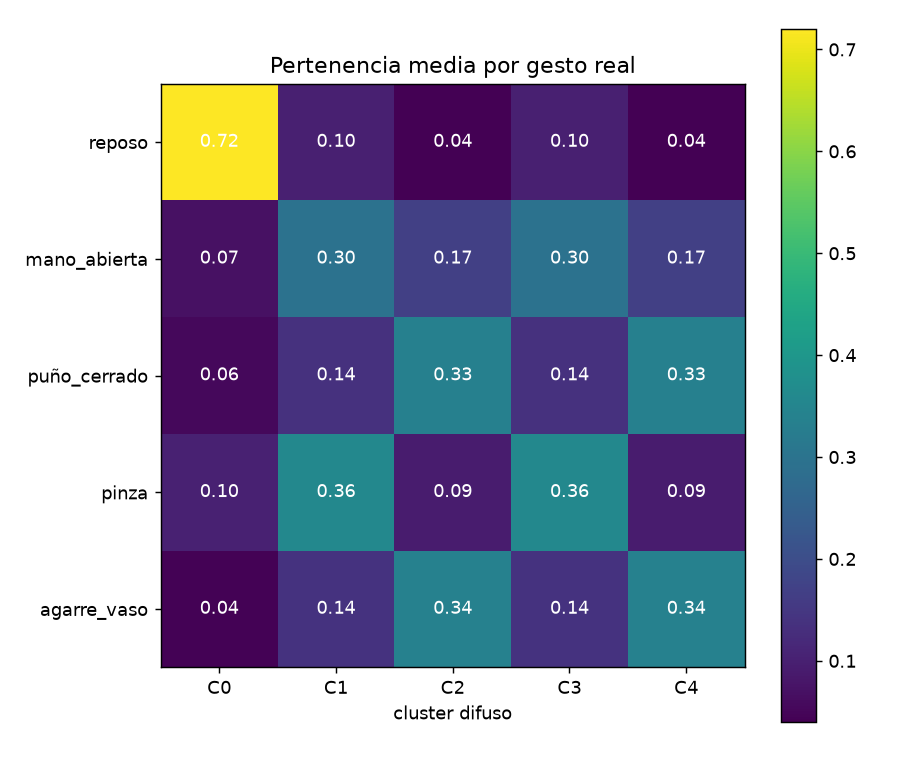
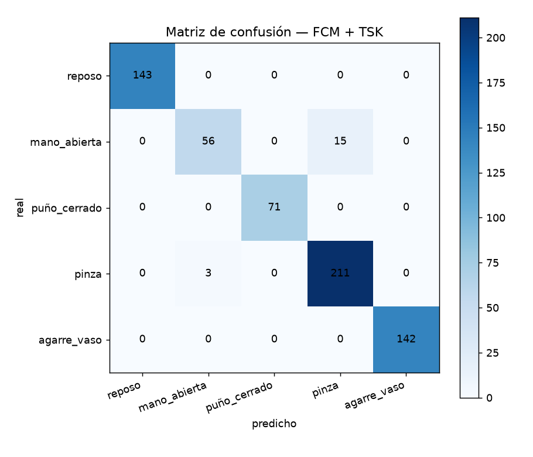
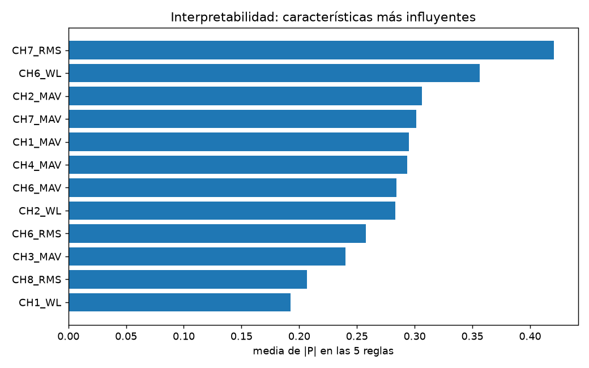
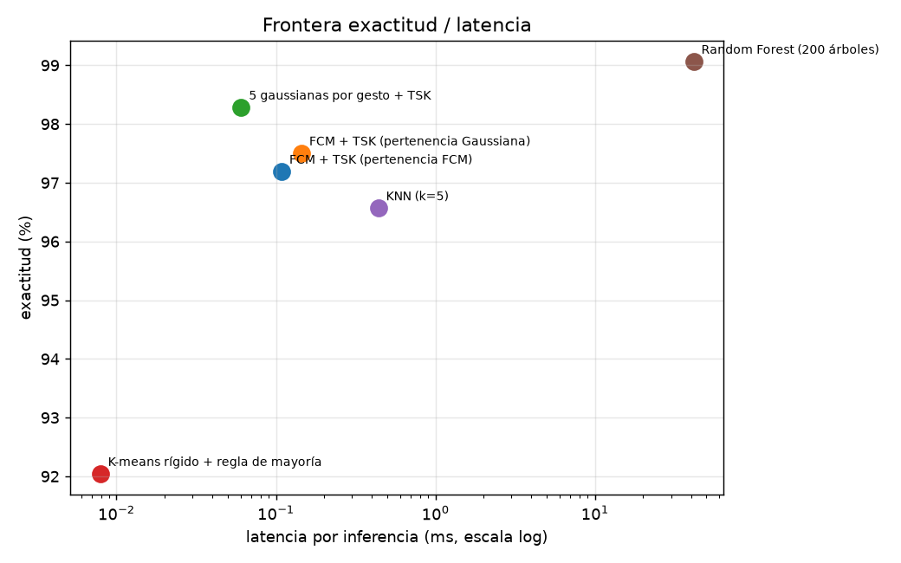
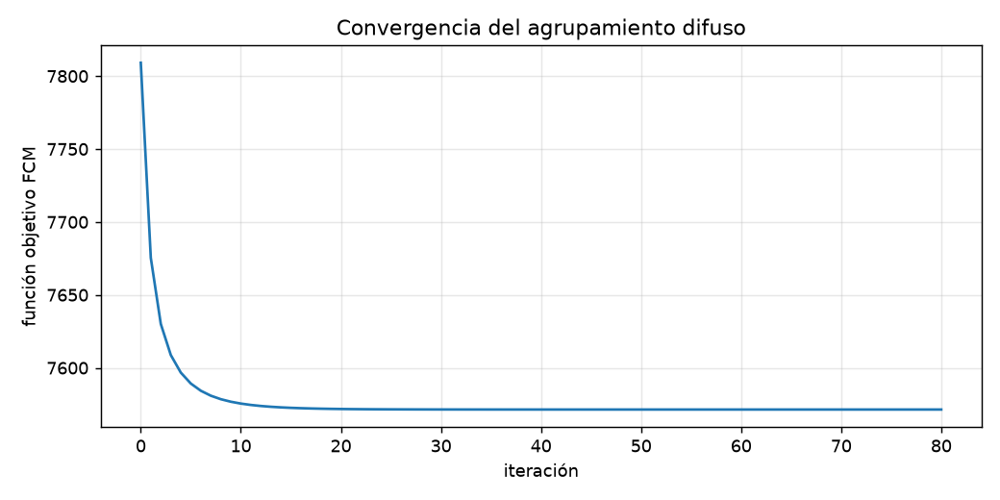

# Resultados experimentales (generados por `src/03_evaluar.py`)

## 1. Partición difusa (FCM)

- Clústeres: **5** (uno por gesto base).
- Exponente de difusividad: **m = 2.0**.
- Iteraciones hasta convergencia: **81**.
- Coeficiente de partición (PC): **0.3454**.
- Entropía de partición (PE): **1.2856**.

PC y PE se calcularon sobre la matriz de pertenencia del conjunto de entrenamiento.
Valores intermedios (PC lejos de 1, PE lejos de 0) indican solapamiento difuso
entre gestos, coherente con la co-contracción muscular.

**Hallazgo:** los 5 centros de FCM colapsan en solo **3 centros distintos**
al converger. Dos pares de gestos comparten estadísticas de Hudgins y no son
separables por prototipos, aunque sí por hiperplanos TSK. Para conservar 5 reglas
semánticas se evaluó una variante con gaussianas ancladas a cada gesto, incluida
en la tabla siguiente y exportada a `outputs/models/modelo_gaussiano_clases.json`.

## 2. Comparación de modelos (mismo split 70/30)

| Modelo | Exactitud | F1-macro | Latencia (ms/muestra) |
| :--- | ---: | ---: | ---: |
| FCM + TSK (pertenencia FCM) | 97.19% | 0.964 | 0.1083 |
| FCM + TSK (pertenencia Gaussiana) | 97.50% | 0.969 | 0.1444 |
| 5 gaussianas por gesto + TSK | 98.28% | 0.979 | 0.0605 |
| K-means rígido + regla de mayoría | 92.04% | 0.906 | 0.0079 |
| KNN (k=5) | 96.57% | 0.955 | 0.4376 |
| Random Forest (200 árboles) | 99.06% | 0.989 | 41.5050 |

> La latencia se mide en Python/NumPy sobre esta máquina. El valor de 0.003 ms
> citado en el contexto corresponde a una implementación optimizada en C para
> hardware embebido; no es directamente comparable con esta medición.

## 3. Desempeño por clase del modelo propuesto

| Gesto | Precisión | Sensibilidad | F1 |
| :--- | ---: | ---: | ---: |
| reposo | 1.000 | 1.000 | 1.000 |
| mano_abierta | 0.949 | 0.789 | 0.862 |
| puño_cerrado | 1.000 | 1.000 | 1.000 |
| pinza | 0.934 | 0.986 | 0.959 |
| agarre_vaso | 1.000 | 1.000 | 1.000 |

Exactitud global del modelo propuesto: **97.19%**.

## 4. Reglas TSK auditables

| Regla | Gesto dominante | 5 características de mayor peso |
| :--- | :--- | :--- |
| R0 | reposo | CH7_RMS, CH6_WL, CH3_WL, CH3_RMS, CH7_MAV |
| R1 | mano_abierta | CH7_RMS, CH6_MAV, CH6_WL, CH4_MAV, CH2_MAV |
| R2 | puño_cerrado | CH2_WL, CH1_MAV, CH7_MAV, CH5_MAV, CH2_RMS |
| R3 | pinza | CH7_RMS, CH6_MAV, CH6_WL, CH4_MAV, CH2_MAV |
| R4 | agarre_vaso | CH2_WL, CH1_MAV, CH7_MAV, CH5_MAV, CH2_RMS |

Las ecuaciones completas están en `outputs/models/modelo_fcm_tsk.json`
(`centros`, `P` de forma 5×5×32 y `q` de forma 5×5).

## 5. Figuras

## 6. Advertencias metodológicas

1. El split es aleatorio por ventanas: hay solapamiento entre train y test
   (fuga de información), por lo que la exactitud reportada es optimista.
2. `TRIM=0` reproduce las 2.139 ventanas del contexto; el script original usa
   `TRIM=50` (2.125 ventanas) para descartar transiciones.
3. La normalización z-score se ajustó solo con entrenamiento.

## 7. Análisis comparativo (nivel maestría)

Este informe describe **qué** ocurrió. La discusión de **por qué** esta
configuración frente a CNN-BiLSTM, TCN int8, Random Forest, Mamdani y ANFIS
(complejidad, huella de memoria, interpretabilidad, fisiología y Pareto) está
en [`05_analisis_comparativo.md`](05_analisis_comparativo.md), generado por
`src/07_analisis_comparativo.py`.
