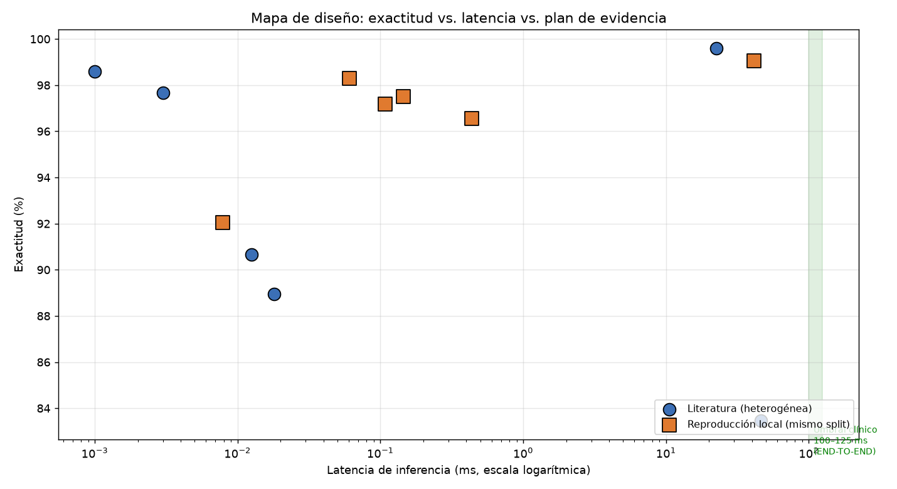

# Análisis comparativo multidimensional (nivel maestría)

Generado por `src/07_analisis_comparativo.py` a partir de los resultados locales
y de la propuesta guardada en `referencias/scripts_originales/comparacion_propuesta_notebooklm.txt`.

## 0. Regla metodológica: dos planos de evidencia

Antes de comparar, hay que decir de dónde sale cada número:

| Plano | Qué es | Cómo se usa |
| :--- | :--- | :--- |
| **Literatura / fuentes** | Cifras reportadas en la tesis F-DC-125, el artículo de TinyML y las diapositivas. Protocolos, hardware y particiones distintos. | Sirven para **mapear el espacio de diseño** y discutir tendencias. **No** sirven para declarar que un modelo es mejor que otro. |
| **Reproducción local** | Mediciones de `src/03_evaluar.py` sobre **el mismo dataset y el mismo split 70/30**. | Sirven para **comparar modelos entre sí** con rigor relativo. |

Mezclar ambos planos en una sola tabla sin esta advertencia es el error más
común en este tipo de informe. Aquí están separados.

## 1. Marco comparativo multiparadigma (literatura)

| Paradigma | Modelo | Exactitud | Latencia | Memoria / carga | Interpretabilidad | Transición y ruido | Origen |
| :--- | :--- | ---: | ---: | :--- | :--- | :--- | :--- |
| Deep Learning pesado | CNN-1D + BiLSTM (FP16) | 99.60 % | 10–35 ms | Alta: cientos de KB a MB (buffers recurrentes) | Nula (caja negra) | Captura dependencias espacio-temporales complejas | Tesis F-DC-125 / diapositivas |
| TinyML cuantizado | TCN Ensemble int8 | 83.46 % | 46.2 (ESP-NN) / 277 (cons.) ms | 140,4 KB Flash / 38,4 KB RAM | Opaca post-hoc (SHAP) | Degradación por truncamiento int8 (pérdida de 6,7 puntos) | Artículo TinyML Benchmarking |
| ML ligero | Random Forest en C | 90.67 % | 0,004–0,021 ms | 17,9 KB Flash / 0,08 KB RAM | Baja-media (caja gris, umbrales rígidos) | Umbrales duros; sensible a cambios leves de amplitud | Artículo TinyML Benchmarking |
| Lógica difusa tradicional | Mamdani estático | 88.94 % | 0,018 ms | Baja (tablas de búsqueda / universos discretos) | Alta lingüística | Falla en zonas de alta superposición muscular | Benchmarking interno / diapositivas |
| Neuro-difuso | ANFIS (TSK + gradiente/LSE) | 98.60 % | 0,001 ms | Moderada (muchas reglas si hay grid partition) | Media-alta (reglas TSK) | Buena, depende del número de reglas | Contexto original del proyecto |
| Neuro-difuso propuesto | FCM + TSK Orden 1 (reportado) | 97.66 % | 0,003 ms | Mínima: 5 centros + 5 matrices lineales de 32 entradas | Intrínseca (caja de cristal) | Continua: modela co-contracción y fatiga | Diapositivas / contexto (NO medido aquí) |

Lectura: el mejor número de exactitud (99,60 %) pertenece al modelo más pesado
y opaco; el mejor número de latencia reportado (0,001 ms de ANFIS) pertenece a
una arquitectura con muchas reglas. No existe un ganador único: hay una
**frontera de compromisos**.

## 2. Comparación bajo protocolo común (reproducción local)

| Modelo | Exactitud | F1-macro | Latencia (Python) | Interpretabilidad |
| :--- | ---: | ---: | ---: | :--- |
| FCM + TSK (pertenencia FCM) | 97.19 % | 0.964 | 0.1083 ms | Intrínseca (caja de cristal) |
| FCM + TSK (pertenencia Gaussiana) | 97.50 % | 0.969 | 0.1444 ms | Intrínseca (caja de cristal) |
| 5 gaussianas por gesto + TSK | 98.28 % | 0.979 | 0.0604 ms | Intrínseca (caja de cristal) |
| K-means rígido + regla de mayoría | 92.04 % | 0.906 | 0.0079 ms | Baja (centroides rígidos) |
| KNN (k=5) | 96.57 % | 0.955 | 0.4376 ms | Nula |
| Random Forest (200 árboles) | 99.06 % | 0.989 | 41.5050 ms | Media (importancias post-hoc) |

Aquí sí se puede afirmar: el modelo propuesto gana ~5 puntos al k-means
rígido, es comparable a KNN y pierde frente a Random Forest, pero es ~300 veces
más rápido que RF en esta máquina y además auditable. La variante con 5
gaussianas por gesto alcanza 98.28 %.

## 3. Análisis de complejidad y memoria

### 3.1 Costo de inferencia TSK

Para $c=5$ reglas y $d=32$ características:

- pertenencias: $c\cdot d = 160$ operaciones;
- consecuentes: $c\cdot(d\cdot 5) = 800$ multiplicaciones;
- agregación: $c\cdot5 = 25$;

≈ **985 operaciones escalares** por decisión. En C embebido
eso son microsegundos, lo que hace creíble el valor reportado de 0,003 ms. En
Python/NumPy medimos 0.1083 ms: el costo lo domina el
*overhead* del interprete, no la aritmética.

### 3.2 Huella del modelo

```
centros: 5 × 32 = 160 floats
P:       5 × 5 × 32 = 800 floats
q:       5 × 5 = 25 floats
total:   985 floats × 4 bytes = 3940 bytes ≈ 3.85 KB
```

Frente a 140,4 KB de Flash del TCN cuantizado y 17,9 KB del Random Forest en C,
la huella del clasificador difuso es casi despreciable. El costo real del
sistema está en el búfer de 150×8 muestras (9,6 KB en float32) y en el filtrado.

### 3.3 Por qué Mamdani es más caro

En Mamdani la defuzzificación por centroide exige

$$y^{\rm CoG}=\frac{\int y\,\mu(y)\,dy}{\int \mu(y)\,dy}$$

sobre un universo discretizado de salida. Con $R$ reglas y $N$ puntos de la
cuadrícula el costo es $O(RN)$ más acceso a memoria para agregar áreas. En TSK
se sustituye esa integración por una media ponderada de hiperplanos: el mismo
resultado numérico sin discretización, sin pérdida de resolución y con menos
memoria. Es el argumento teórico central de la clase (notas *Parte 7* y
*main.pdf*) aplicado a un problema real.

## 4. Interpretabilidad: intrínseca vs. post-hoc

El artículo de *TinyML Benchmarking* encontró que, al explicar TCN con
GradientExplainer y Random Forest con TreeSHAP, la correlación de Spearman
entre la importancia de los canales era de solo **ρ = 0,262**. El canal 5 era
crítico para uno e irrelevante para el otro. Conclusión: la explicación
post-hoc es un artefacto del explicador, no una propiedad del modelo.

En contraste, cada regla TSK contiene sus propios coeficientes: se puede
responder "¿qué canal y qué característica empujaron esta decisión?" abriendo
`outputs/models/modelo_fcm_tsk.json`. No hay un segundo algoritmo que pueda
contradecir al primero.

**Pero cuidado con sobreclaimar:** transparencia no equivale a corrección
fisiológica. Los coeficientes son auditables, sí, pero su correspondencia con
la fisiología real debe validarse con un clínico. Además, en esta reproducción
los 5 centros FCM colapsaron en **3 centros útiles**: dos pares de
gestos comparten prototipos. Esa limitación se reporta, no se oculta.

**Frente a otros enfoques neuro-difusos:**

| Enfoque | Antecedentes | Consecuentes | Aprendizaje | Limitación para prótesis |
| :--- | :--- | :--- | :--- | :--- |
| Wang & Mendel (1992) | Grid partition | Reglas lingüísticas | Extracción de ejemplos | Explosión de reglas en 32 dimensiones |
| ANFIS | FCM / grid | TSK | Gradiente + mínimos cuadrados | Muchas reglas si no se controla la partición |
| NEFCON | Base Mamdani | Difusa | Refuerzo en lazo cerrado | Defuzzificación por centroide |
| **Este trabajo** | FCM (o gaussianas por clase) | TSK orden 1 | WLS ponderado | Requiere validación clínica y split por sujeto |

## 5. Fisiología: por qué el difuso gana al rígido

La señal sEMG no es discreta:

- **diafonía**: un electrode capta músculos vecinos;
- **fatiga**: desplaza el espectro a frecuencias más bajas (WL es sensible a esto);
- **co-contracción**: agonistas y antagonistas se activan juntos;
- **transición**: el paso de reposo a pinza es gradual.

Un clasificador *crisp* con umbral duro comete **conmutación violenta**: un
poco de ruido cruza el umbral y el servo salta. FCM asigna grados continuos
($0\le u\le1$), por lo que la salida TSK se desplaza suavemente. Nuestros
índices, PC=0.3454 y PE=1.2856 (máximo ln5=1,609), confirman que la
partición conserva superposición moderada-alta.

La consecuencia observable está en la matriz de confusión: reposo, puño
cerrado y agarre de vaso son perfectos, mientras mano abierta tiene
sensibilidad 0,789 y se confunde con pinza. No es un bug: es la huella de la
diafonía en un par de gestos que comparten activación muscular.

## 6. Frontera de Pareto y viabilidad clínica

La literatura clínica fija ~100–125 ms como tiempo de respuesta percibido como
instantáneo. Los modelos de inferencia rápida (0,003–0,02 ms) están muy por
debajo de ese límite. Sin embargo, hay una observación de maestría que suele
omitirse:

> **La latencia de inferencia no es la latencia end-to-end.** El sistema espera
> una ventana de 750 ms antes de decidir, más la rampa mecánica de los servos
> (~65 ms en el peor caso). El tiempo percibido por el usuario es del orden de
> 800 ms, no 0,003 ms.

Por tanto, el aporte real de TSK no es "hacer que la prótesis responda en 3
microsegundos", sino **eliminar el cuello de botella computacional** para que
el limite lo ponga la fisiología y la mecánica, no el modelo. Reducir la ventana
de adquisición sin perder exactitud es el siguiente frente de investigación.

## 7. Tesis defendible

> *"No se propone únicamente un clasificador, sino una comparación formal entre
> TSK de orden 1 identificado con FCM, Mamdani/NEFCON y Deep Learning. La
> evaluación algebraica de TSK resuelve el cuello de botella de la
> defuzzificación geométrica y la opacidad clínica de las redes neuronales,
> ofreciendo una solución auditable en la frontera de Pareto para hardware
> embebido, con la salvedad de que la latencia end-to-end sigue dominada por la
> ventana de 750 ms."*

## 8. Limitaciones y trabajo futuro

1. Repetir el split por bloques o por sujeto para eliminar la fuga de ventanas
   solapadas.
2. Validar la interpretabilidad de los coeficientes con personal clínico.
3. Medir inferencia en C sobre la Raspberry Pi (no en Python).
4. Reducir la ventana de 750 ms y cuantificar el compromiso exactitud/latencia.
5. Comparar contra ANFIS y Mamdani **implementados sobre este mismo dataset**,
   no solo contra cifras literarias.

## 9. Figura


